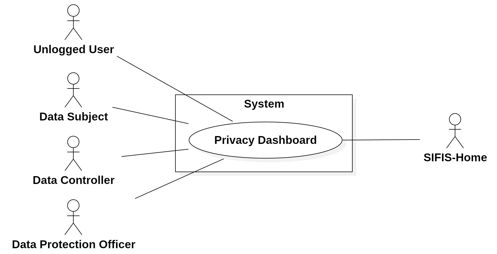

# Requirements Document - Privacy Dashboard

A web application for dynamic privacy consent management integrated with a smart home system.

## Contents

- [Overall description](#overall-description)
- [Stakeholders](#stakeholders)
- [Context Diagram and Interfaces](#context-diagram-and-interfaces)
  - [Context Diagram](#context-diagram)
  - [Interfaces](#interfaces)
- [Requirements](#requirements)
  - [Functional Requirements](#functional-requirements)
  - [Non Functional Requirements](#non-functional-requirements)
  - [Domain](#domain)
- [Use Case Diagram and Use Cases](#use-case-diagram-and-use-cases)
  - [Use Case Diagram](#use-case-diagram)
  - [Use Cases](#use-cases)
- [Glossary](#glossary)
- [System Design](#deployment-diagram)
- [Deployment Diagram](#deployment-diagram)

## Overall description

Privacy Dashboard is a web application designed with the main goal of dynamically collecting, managing, and monitoring user privacy consents within their smart home. More specifically, it allows to:

- Handle personal data: Data Subjects are able to view and easily configure which personal data is collected by IoT devices installed in their smart home.
- Dynamically configure IoT devices: Data Subjects' choices are translated into automatic device configuration, in order to prevent the collection and transmission of unwanted data to third-party services. This is achieved through the interaction of Privacy Dashboard with the SIFIS-Home framework using dedicated APIs.
- Exercise GDPR rights: Data Subjects can exercise their GDPR rights (access, withdrawal, portability, erasure, limitation and complaint) directly from the platform, with a user-friendly interface.
- Interact directly with Data Controllers and Data Protection Officer: the dashboard works as a centralized point to put in touch Data Subjects with all the Data Controllers and the Data Protection Officer involved, simplifying the management of requests related to personal data.
- Support Data Controllers and Data Protection Officer: the dashboard includes specific functionalities to help Data Controllers and the Data Protection Officer in defining policies of data management in a simple and comprehensible way, to be applicable directly to the users themselves.

## Stakeholders

| Stakeholder name         |                                          Description                                                                                                                          |
| :----------------------: | :---------------------------------------------------------------------------------------------------------------------------------------------------------------------------: |
|  Unlogged User           |                    User of the application who logs in or creates a new account                                                                                               |
|  Data Subject            | User of the application who handles his personal data, configures his devices, exercises his GDPR rights and interacts with Data Controllers and Data Protection Officer      |
|  Data Controller         | User of the application who verifies compliance with the Data Subject's privacy preferences and GDPR regulations, handles privacy notices and interacts with Data Subjects, other Data Controllers and the Data Protection Officer |
|  Data Protection Officer | User of the application who has similar privileges as Data Controller, but is unique to the application; that is, unlike Data Controller and Data Subject, there can only be one user with this role |
|    SIFIS-Home            | External framework that allows to dynamically configure IoT devices in the smart home and interacts with Privacy Dashboard through dedicated APIs                             |
|  Administrator           |                       Person who owns and manages the application                                                                                                             |
|    Developer             |                       Person who develops and maintains the application                                                                                                       |

## Context Diagram and Interfaces

### Context Diagram

### Interfaces

|     Actor               | Physical Interface         | Logical Interface  |
| :---------------------: | :------------------------: | :----------------: |
| Unlogged User           | Personal computing device  |         GUI        |
| Data Subject            | Personal computing device  |         GUI        |
| Data Controller         | Personal computing device  |         GUI        |
| Data Protection Officer | Personal computing device  |         GUI        |
|    SIFIS-Home           | Internet connection        |         API        |

## Requirements

### Functional Requirements

### Non Functional Requirements

### Domain

## Use Case Diagram and Use Cases

### Use Case Diagram

### Use Cases

## Glossary

## System Design

## Deployment Diagram
