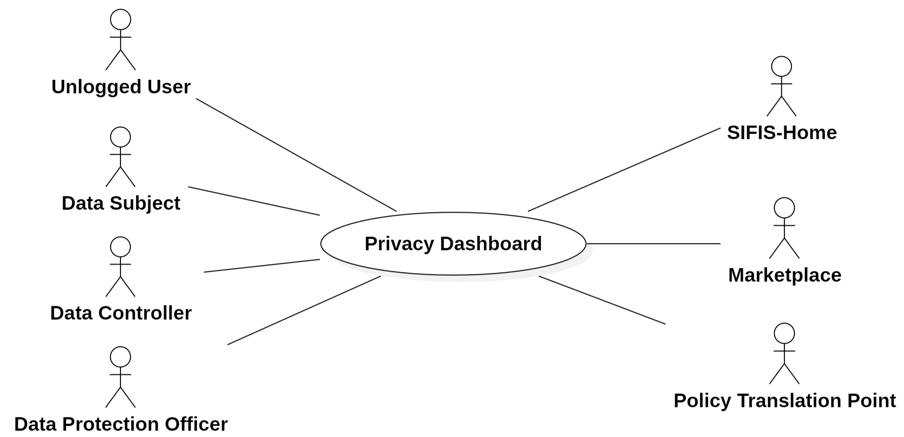
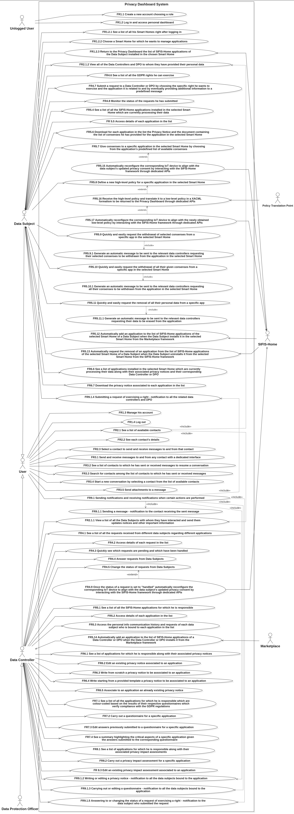
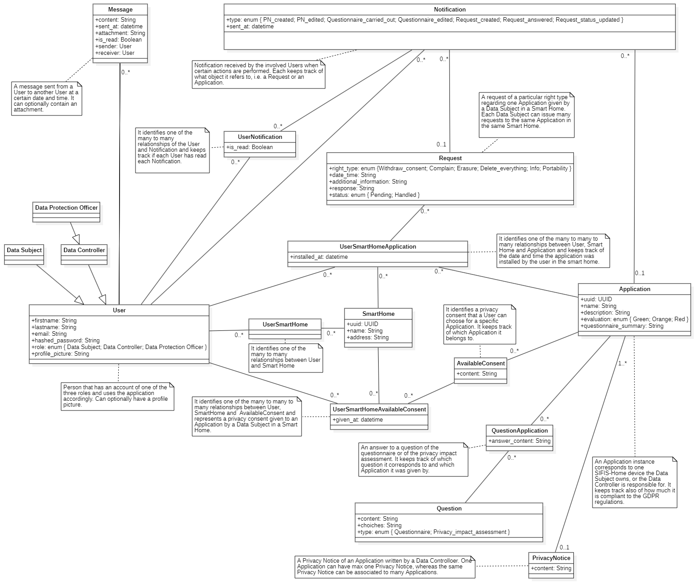
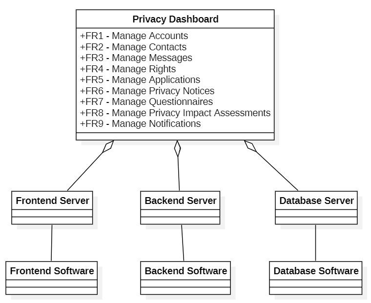
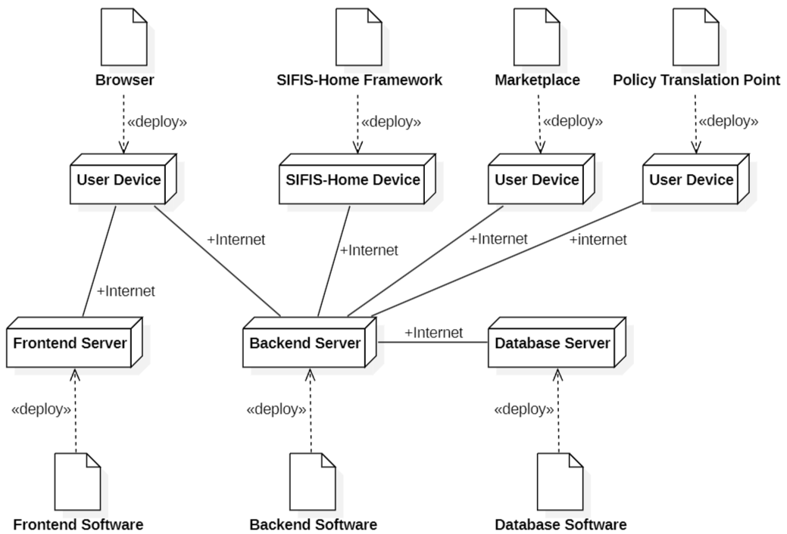

# Requirements Document - Privacy Dashboard

A web application for dynamic privacy consent management integrated with a smart home system.

## Contents

- [Overall description](#overall-description)
- [Stakeholders](#stakeholders)
- [Context Diagram and Interfaces](#context-diagram-and-interfaces)
  - [Context Diagram](#context-diagram)
  - [Interfaces](#interfaces)
- [Requirements](#requirements)
  - [Functional Requirements](#functional-requirements)
  - [Non Functional Requirements](#non-functional-requirements)
- [Use Case Diagram and Use Cases](#use-case-diagram-and-use-cases)
  - [Use Case Diagram](#use-case-diagram)
  - [Use Cases](#use-cases)
    - [Use Case 1, Create a new account (UC1)](#use-case-1-create-a-new-account-uc1)
      - [Scenario 1.1](#scenario-11)
      - [Scenario 1.2](#scenario-12)
      - [Scenario 1.3](#scenario-13)
      - [Scenario 1.4](#scenario-14)
    - [Use Case 2, Log in (UC2)](#use-case-2-log-in-uc2)
      - [Scenario 2.1](#scenario-21)
      - [Scenario 2.2](#scenario-22)
      - [Scenario 2.3](#scenario-23)
      - [Scenario 2.4](#scenario-24)
    - [Use Case 3, Manage account (UC3)](#use-case-3-manage-account-uc3)
      - [Scenario 3.1](#scenario-31)
      - [Scenario 3.2](#scenario-32)
    - [Use Case 4, Log out (UC4)](#use-case-4-log-out-uc4)
      - [Scenario 4.1](#scenario-41)
      - [Scenario 4.2](#scenario-42)
    - [Use Case 5, Manage messages (UC5)](#use-case-5-manage-messages-uc5)
      - [Scenario 5.1](#scenario-51)
      - [Scenario 5.2](#scenario-52)
    - [Use Case 6, Manage Rights - Data Controller or DPO (UC6)](#use-case-6-manage-rights---data-controller-or-dpo-uc6)
      - [Scenario 6.1](#scenario-61)
    - [Use Case 7, Manage Rights - Data Subject (UC7)](#use-case-7-manage-rights---data-subject-uc7)
      - [Scenario 7.1](#scenario-71)
    - [Use Case 8, Manage Applications - Data Controller or DPO (UC8)](#use-case-8-manage-applications---data-controller-or-dpo-uc8)
      - [Scenario 8.1](#scenario-81)
    - [Use Case 9, Manage Applications - Data Subject (UC9)](#use-case-9-manage-applications---data-subject-uc9)
      - [Scenario 9.1](#scenario-91)
      - [Scenario 9.2](#scenario-92)
      - [Scenario 9.3](#scenario-93)
    - [Use Case 10, Manage Privacy Notices - Data Controller or DPO (UC10)](#use-case-10-manage-privacy-notices---data-controller-or-dpo-uc10)
      - [Scenario 10.1](#scenario-101)
      - [Scenario 10.2](#scenario-102)
      - [Scenario 10.3](#scenario-103)
      - [Scenario 10.4](#scenario-104)
    - [Use Case 11, Manage Privacy Notices - Data Subject (UC11)](#use-case-11-manage-privacy-notices---data-subject-uc11)
      - [Scenario 11.1](#scenario-111)
    - [Use Case 12, Manage Questionnaires - Data Controller or DPO (UC12)](#use-case-12-manage-questionnaires---data-controller-or-dpo-uc12)
      - [Scenario 12.1](#scenario-121)
      - [Scenario 12.2](#scenario-122)
    - [Use Case 13, Manage Privacy Impact Assessments - Data Controller or DPO (UC13)](#use-case-13-manage-privacy-impact-assessments---data-controller-or-dpo-uc13)
      - [Scenario 13.1](#scenario-131)
      - [Scenario 13.2](#scenario-132)
- [Glossary](#glossary)
- [System Design](#system-design)
- [Deployment Diagram](#deployment-diagram)

## Overall description

Privacy Dashboard is a web application designed with the main goal of dynamically collecting, managing, and monitoring user privacy consents within their smart homes. More specifically, it allows to:

- Handle personal data: Data Subjects are able to view and easily configure which personal data is collected by IoT devices installed in their smart homes.
- Dynamically configure IoT devices: Data Subjects' choices are translated into automatic device configuration, in order to prevent the collection and transmission of unwanted data to third-party services. This is achieved through the interaction of Privacy Dashboard with the SIFIS-Home framework using dedicated APIs.
- Exercise GDPR rights: Data Subjects can exercise their GDPR rights (access, withdrawal, portability, erasure, limitation and complaint) directly from the platform, with a user-friendly interface.
- Interact directly with Data Controllers and Data Protection Officer: the dashboard works as a centralized point to put in touch Data Subjects with all the Data Controllers and the Data Protection Officer involved, simplifying the management of requests related to personal data.
- Support Data Controllers and Data Protection Officer: the dashboard includes specific functionalities to help Data Controllers and the Data Protection Officer in defining policies of data management in a simple and comprehensible way, to be applicable directly to the users themselves.

## Stakeholders

| Stakeholder name         |                                          Description                                                                                                                          |
| :----------------------: | :---------------------------------------------------------------------------------------------------------------------------------------------------------------------------: |
|  Unlogged User           |                    User of the application who logs in or creates a new account                                                                                               |
|  Data Subject            | User of the application who handles his personal data, configures his devices, exercises his GDPR rights and interacts with Data Controllers and Data Protection Officer      |
|  Data Controller         | User of the application who verifies compliance with the Data Subject's privacy preferences and GDPR regulations, handles privacy notices and interacts with Data Subjects, other Data Controllers and the Data Protection Officer |
|  Data Protection Officer | User of the application who has similar privileges as Data Controller, but is unique to the application; that is, unlike Data Controller and Data Subject, there can only be one user with this role |
|    SIFIS-Home            | External framework that allows to dynamically configure IoT devices in the smart home and interacts with Privacy Dashboard through dedicated APIs                             |
|    Marketplace           | External framework that allows Users to manage their applications and interacts with Privacy Dashboard through dedicated APIs         |
| Policy Translation Point | External framework that allows Data Subject to translate high-level security policies like “Do not record sound in the living room tonight” into low-level policies in a XACML formalism, and interacts with Privacy Dashboard through dedicated APIs         |
|  Administrator           |                       Person who owns and manages the application                                                                                                             |
|    Developer             |                       Person who develops and maintains the application                                                                                                       |

## Context Diagram and Interfaces

### Context Diagram

### Interfaces

|     Actor               | Physical Interface         | Logical Interface  |
| :---------------------: | :------------------------: | :----------------: |
| Unlogged User           | Personal computing device  |         GUI        |
| Data Subject            | Personal computing device  |         GUI        |
| Data Controller         | Personal computing device  |         GUI        |
| Data Protection Officer | Personal computing device  |         GUI        |
|    SIFIS-Home           | Internet connection        |         API        |
|    Marketplace          | Internet connection        |         API        |
| Policy Translation Point | Internet connection        |         API        |

## Requirements

### Functional Requirements

|   ID    |                              Name                              |
| :-----: | :------------------------------------------------------------: |
| **FR1** |                       **Manage Accounts**                       |
|  FR1.1  | Enable the Unlogged User to create a new account choosing a role which is one of the following: Data Subject, Data Controller, Data Protection Officer. |
|  FR1.2  | Enable the Unlogged User to log in and access his personal dashboard.    |
|  FR1.2.1 | Enable Data Subject to see a list of all his Smart Homes right after logging in. |
|  FR1.2.2 | Enable Data Subject to choose a Smart Home for which he wants to manage applications. |
|  FR1.2.3 | Enable the SIFIS-Home framework to return to the Privacy Dashboard the list of SIFIS-Home applications of the Data Subject installed in the chosen Smart Home. |
|  FR1.3  | Enable the user to manage his account, including changing his email and password.    |
|  FR1.4  | Enable the user to log out.    |
| **FR2** |                       **Manage Contacts**                       |
|  FR2.1  | Enable the user to see a list of available contacts. |
|  FR2.1.1  | Enable Data Controller and DPO to view a list of all the Data Subjects with whom they have interacted and send them updates, notices, and other important information. |
|  FR2.1.2  | Enable Data Subject to view all of the Data Controllers and DPO to whom they have provided their personal data. |
|  FR2.2  | Enable the user to see each contact's details, including name, email if any, role, and apps related to that contact. |
|  FR2.3  | Enable the user to select a contact to send and receive messages to and from that contact. |
| **FR3** |                       **Manage Messages**                       |
|  FR3.1  | Enable the user to send and receive messages to and from any contact with a dedicated interface. |
|  FR3.2  | Enable the user to see a list of contacts to which he has sent or received messages to resume a conversation. |
|  FR3.3  | Enable the user to search for contacts by name, email, or role among the list of contacts to which he has sent or received messages. |
|  FR3.4  | Enable the user to start a new conversation by selecting a contact from the list of available contacts. |
|  FR3.5  | Enable the user to send attachments to a message. |
| **FR4** |                       **Manage Rights**                       |
|  FR4.1  | Enable Data Controller and DPO to see a list of all the requests received from different data subjects regarding different applications installed in their different Smart Homes. |
|  FR4.2  | Enable Data Controller and DPO to access details of each request in the list, including the type of request, the application it is related to, the date it was received, the current status of the request, the data subject's name and the specific right being exercised. |
|  FR4.3  | Enable Data Controller and DPO to quickly see which requests are pending and which have been handled. |
|  FR4.4  | Enable Data Controller and DPO to answer requests from Data Subjects. |
|  FR4.5  | Enable Data Controller and DPO to change the status of requests from Data Subjects. |
|  FR4.6  | Enable Data Subject to see a list of all the GDPR rights he can exercise. |
|  FR4.7  | Enable Data Subject to submit a request to a Data Controller or DPO by choosing the specific right he wants to exercise and the application it is related to and by eventually providing additional information to a predefined message. |
|  FR4.8  | Enable Data Subject to monitor the status of the requests he has submitted. |
|  FR4.9  | Once the status of a request is set to "handled", automatically reconfigure the corresponding IoT device to align with the data subject's updated privacy consent by interacting with the SIFIS-Home framework through dedicated APIs. |
| **FR5** |                       **Manage Applications**                       |
|  FR5.1  | Enable Data Controller and DPO to see a list of all the SIFIS-Home applications for which he is responsible. |
|  FR5.2  | Enable Data Controller and DPO to access details of each application in the list, including the application's name, description, evaluation, Privacy Notice, other joint data controllers or DPO if any, and the list of all data subjects who are bound to the application. |
|  FR5.3  | Enable Data Controller and DPO to access the personal info, communication history and requests of each data subject who is bound to each application in the list. |
|  FR5.4  | Enable Data Subject to see a list of all the SIFIS-Home applications installed in the selected Smart Home which are currently processing their data. |
| FR5.5 | Enable Data Subject to access details of each application in the list, including the application's name, description, evaluation, Privacy Notice, the list of all data controllers and DPO involved in the processing of their data, the list of consents he has provided, and the list of high-level policies he has defined. |
| FR5.6 | Enable Data Subject to download, for each application in the list, the Privacy Notice and the document, including as a XML and as a JSON, containing the list of consents he has provided for the application in the selected Smart Home. |
| FR5.7 | Enable Data Subject to give consents to a specific application in the selected Smart Home by choosing from the application's predefined list of available consents. |
| FR5.8 | Enable Data Subject to define a new high-level policy for a specific application in the selected Smart Home. |
| FR5.9 | Enable Data Subject to quickly and easily request the withdrawal of selected consents from a specific app in the selected Smart Home. |
| FR5.9.1 | Generate an automatic message to be sent to the relevant data controllers, requesting their selected consents to be withdrawn from the application in the selected Smart Home. |
| FR5.10 | Enable Data Subject to quickly and easily request the withdrawal of all their given consents from a specific app in the selected Smart Home. |
| FR5.10.1 | Generate an automatic message to be sent to the relevant data controllers, requesting all their consents to be withdrawn from the application in the selected Smart Home. |
| FR5.11  | Enable the Data Subject to quickly and easily request the removal of all their personal data from a specific app. |
| FR5.11.1 | Generate an automatic message to be sent to the relevant data controllers, requesting their data to be erased from the application. |
| FR5.12 | Enable the SIFIS-Home framework to automatically add an application to the list of SIFIS-Home applications of the selected Smart Home of a Data Subject when the Data Subject installs it in the selected Smart Home from the Marketplace framework. |
| FR5.13 | Enable the SIFIS-Home framework to automatically request the removal of an application from the list of SIFIS-Home applications of the selected Smart Home of a Data Subject when the Data Subject uninstalls it from the selected Smart Home from the SIFIS-Home framework. |
| FR5.14 | Enable the Marketplace framework to automatically add an application to the list of SIFIS-Home applications of a Data Controller or DPO when the Data Controller or DPO installs it from the Marketplace framework. |
| FR5.15 | Automatically reconfigure the corresponding IoT device to align with the data subject's updated privacy consent by interacting with the SIFIS-Home framework through dedicated APIs. |
| FR5.16 | Enable the Policy Translation Point framework to receive the high-level policy and translate it to a low-level policy in a XACML formalism to be returned to the Privacy Dashboard through dedicated APIs. |
| FR5.17 | Automatically reconfigure the corresponding IoT device to align with the newly obtained low-level policy by interacting with the SIFIS-Home framework through dedicated APIs. |
| **FR6** |                       **Manage Privacy Notices**                       |
| FR6.1   | Enable the Data Controller and DPO to see a list of applications for which he is responsible along with their associated privacy notices, if any. |
| FR6.2   | Enable Data Controller and DPO to edit an existing privacy notice associated to an application. |
| FR6.3   | Enable Data Controller and DPO to write from scratch a privacy notice to be associated to an application. |
| FR6.4   | Enable Data Controller and DPO to write, starting from a provided template, a privacy notice to be associated to an application. |
| FR6.5   | Enable Data Controller and DPO to associate to an application an already existing privacy notice. |
| FR6.6   | Enable Data Subject to see a list of applications installed in the selected Smart Home which are currently processing their data along with their associated privacy notices and their corresponding Data Controller or DPO. |
| FR6.7   | Enable Data Subject to download the privacy notice associated to each application in the list. |
| **FR7** |                       **Manage Questionnaires**                       |
| FR7.1  | Enable Data Controller and DPO to see a list of all the applications for which he is responsible, which are colour-coded based on the results of their respective questionnaires which verify compliance with the GDPR regulations.  |
| FR7.2  | Enable Data Controller and DPO to carry out a questionnaire for a specific application. |
| FR7.3  | Enable Data Controller and DPO to edit answers previously submitted to a questionnaire for a specific application. |
| FR7.4  | Enable Data Controller and DPO to see a summary highlighting the critical aspects of a specific application given the answers submitted to the corresponding questionnaire. |
| **FR8** |                       **Manage Privacy Impact Assessments**                       |
| FR8.1   | Enable the Data Controller and DPO to see a list of applications for which he is responsible along with their associated privacy impact assessments, if any. |
| FR8.2   | Enable Data Controller and DPO to carry out a privacy impact assessment for a specific application. |
| FR8.3   | Enable Data Controller and DPO to edit an existing privacy impact assessment associated to an application. |
| **FR9** |                       **Manage Notifications**                       |
| FR9.1  | Sending notifications and receiving notifications when certain actions are performed. |
| FR9.1.1  | Sending a message: notification to the contact receiving the sent message. |
| FR9.1.2  | Writing or editing a privacy notice: notification to all the data subjects bound to the application. |
| FR9.1.3  | Carrying out or editing a questionnaire: notification to all the data subjects bound to the application. |
| FR9.1.4  | Submitting a request of exercising a right: notification to all the related data controllers and DPO. |
| FR9.1.5  | Answering to or changing the status of a request of exercising a right: notification to the data subject who submitted the request. |

### Non Functional Requirements

|  ID   | Type (efficiency, reliability, ..) |                                       Description                                       |
| :---: | :--------------------------------: | :-------------------------------------------------------------------------------------: |
| NFR1  |             Efficiency             |                         Response time should be less than 0.5 s                         |
| NFR2  |            Reliability             |                        No data about users should be lost at all                        |
| NFR3  |            Reliability             |             The web application should be accessible for color-blind people             |
| NFR4  |            Portability             |       The web application should run without problems on all popular browsers           |
| NFR5  |            Portability             |                       The web application should be responsive                          |
| NFR6  |             Usability              | At least 95% of average users (no computer professionals with more than 1 year of experience of using PC) can use the application within 1 hour, with no training |
| NFR7  |               Safety               |          Data exchange should ensure confidentiality, integrity and availability        |
| NFR8  |               Privacy              |               The web application should be fully compliant with GDPR regulations       |

## Use Case Diagram and Use Cases

### Use Case Diagram

### Use Cases

#### Use Case 1, Create a new account (UC1)

| Actors Involved  |          Unlogged User           |
| :--------------: | :------------------------------: |
|   Precondition   | The user doesn't have an account |
|  Post condition  |         User registered          |
| Nominal Scenario |           Scenario 1.1           |
|     Variants     |               None               |
|    Exceptions    |        Scenario 1.2, 1.3, 1.4    |

##### Scenario 1.1

|  Scenario 1.1  |                                                    Registration                                                    |
| :------------: | :----------------------------------------------------------------------------------------------------------------: |
|  Precondition  |                                          The user doesn't have an account                                          |
| Post condition |                                                  User registered                                                   |
|     Step#      |                                                    Description                                                     |
|       1        |                                               User: Asks to register                                                |
|       2        |                                System: asks username, name, surname, role, email, password                          |
|       3        |                               User: Provides username, name, surname, role, email, password                         |
|       4        |                                System: Reads username, name, surname, role, email, password                         |
|       5        | System: Checks that the provided username or email aren't associated with any account yet. The username and email haven't been used yet. |
|       6        |                               System: Creates a new user and stores their information                                |

##### Scenario 1.2

|  Scenario 1.2  |                                                          Username or email already in use                                                 |
| :------------: | :---------------------------------------------------------------------------------------------------------------------------------------: |
|  Precondition  |                                                          The user has an account                                                          |
| Post condition |                                                            Registration failed                                                            |
|     Step#      |                                                                Description                                                                |
|       1        |                                                           User: Asks to register                                                           |
|       2        |                                            System: asks username, name, surname, role, email, password                                     |
|       3        |                                           User: Provides username, name, surname, role, email, password                                    |
|       4        |                                           System: Reads username, name, surname, role, email, password                                     |
|       5        | System: Checks that the provided username or email aren't associated with any account yet. The username or email have been used already. Provides error message |

##### Scenario 1.3

|  Scenario 1.3  |                                    User provides empty mandatory parameters                                     |
| :------------: | :---------------------------------------------------------------------------------------------------: |
|  Precondition  |                                   The user doesn't have an account                                    |
| Post condition |                                          Registration failed                                          |
|     Step#      |                                              Description                                              |
|       1        |                                         User: Asks to register                                         |
|       2        |                          System: asks username, name, surname, role, email, password                   |
|       3        |                         User: Provides username, name, surname, role, email, password                  |
|       4        |                         System: Reads username, name, surname, role, password                          |
|       5        | System: Checks that all mandatory parameters are filled. At least one mandatory parameter is empty. Provides error message. |

##### Scenario 1.4

|  Scenario 1.4  |                                    Data Protection Officer already exists                             |
| :------------: | :---------------------------------------------------------------------------------------------------: |
|  Precondition  |                                   The user doesn't have an account                                    |
| Post condition |                                          Registration failed                                          |
|     Step#      |                                              Description                                              |
|       1        |                                         User: Asks to register                                         |
|       2        |                          System: asks username, name, surname, role, email, password                   |
|       3        |                         User: Provides username, name, surname, role = DPO, email, password            |
|       4        |                         System: Reads username, name, surname, role = DPO, email, password                    |
|       5        | System: Checks that DPO doesn't exist yet. The DPO has been created already. Provides error message.    |

#### Use Case 2, Log in (UC2)

| Actors Involved  |    Unlogged User        |
| :--------------: | :---------------------: |
|   Precondition   | User U is not logged in |
|  Post condition  |     U is logged in      |
| Nominal Scenario |      Scenario 2.1       |
|     Variants     |          Scenario 2.5   |
|    Exceptions    | Scenario 2.2, 2.3, 2.4  |

##### Scenario 2.1

|  Scenario 2.1  |                                       Successful Login                                       |
| :------------: | :------------------------------------------------------------------------------------------: |
|  Precondition  |                                       U is registered                                        |
| Post condition |                                        U is logged in                                        |
|     Step#      |                                         Description                                          |
|       1        |                              System: Asks for username, password                              |
|       2        |                              User: Provides username, password.                               |
|       3        |                               System: Reads username, password.                               |
|       4        |                            System: Given username, finds the user.                            |
|       5        | System: Retrieves password, compares with the one provided. Passwords match, user is auhorized |

##### Scenario 2.2

|  Scenario 2.2  |                                             Wrong password                                              |
| :------------: | :-----------------------------------------------------------------------------------------------------: |
|  Precondition  |                                             U is registered                                             |
| Post condition |                                             U not logged in                                             |
|     Step#      |                                               Description                                               |
|       1        |                                     System: Asks username password.                                      |
|       2        |                                    User: Provides username, password.                                    |
|       3        |                                    System: Reads username, password.                                     |
|       4        |                                 System: Given username, finds the user.                                  |
|       5        | System: Retrieves password, compares with the one provided. Passwords do not match, user is not auhorized |

##### Scenario 2.3

| Scenario 2.3   |                              User not registered                              |
| -------------- | :---------------------------------------------------------------------------: |
| Precondition   |                              U is not registered                              |
| Post condition |                              User not logged in                               |
| Step#          |                                  Description                                  |
| 1              |                        System: Asks username password.                         |
| 2              |                       User: Provides username, password.                       |
| 3              |                        System: Reads username, password.                       |
| 4              | System: Given username, finds the user. User is not found. User not authorized |

##### Scenario 2.4

| Scenario 2.4   |                     User already logged in                      |
| -------------- | :-------------------------------------------------------------: |
| Precondition   |                         U is registered                         |
| Post condition |                         U is logged in                          |
| Step#          |                           Description                           |
| 1              |                 System: Asks username password.                  |
| 2              |                User: Provides username, password.                |
| 3              | System: Reads username, password. The user is already logged in. |
| 4              |                 System: Returns an error message                 |

##### Scenario 2.5

| Scenario 2.5   |                     User logged in as Data Subject               |
| -------------- | :-------------------------------------------------------------: |
| Precondition   |                         U is registered                         |
| Post condition |                         U is logged in as Data Subject and selects one of this Smart Homes       |
| Step#          |                           Description                           |
| 1              |                 User: Successfully logs in as Data Subject.                  |
| 2              |                System: Shows the list of Smart Homes belonging to the Data Subject. |
| 3              |                User: Selects one of the Smart Homes.             |
| 3              | System: Automatically send a request to the SIFIS-Home framework to retrieve the list of SIFIS-Home applications installed in the selected Smart Home. |
| 4              |                 System: Compares the response with the data present in the database and updates it if necessary to align the data in the database with the list of applications obtained in the response.                |

#### Use Case 3, Manage account (UC3)

| Actors Involved  |        User             |
| :--------------: | :---------------------: |
|   Precondition   | User U is logged in     |
|  Post condition  |     U changed his account informations |
| Nominal Scenario |      Scenario 3.1       |
|     Variants     |          None           |
|    Exceptions    | Scenario 3.2            |

##### Scenario 3.1

|  Scenario 3.1  |                                           User changes account informations                                        |
| :------------: | :----------------------------------------------------------------------------------------------------------------: |
|  Precondition  |                                          User U is logged in                                                       |
| Post condition |                                          U changed his account informations                                        |
|     Step#      |                                                    Description                                                     |
|       1        |                                               User: Asks to change account informations                             |
|       2        |                                System: asks new username, name, surname, email, password                            |
|       3        |                               User: Provides username, name, surname, email, password                         |
|       4        |                                System: Reads username, name, surname, email, password                         |
|       5        | System: Checks that the provided username or email aren't associated with any account yet. The username and email haven't been used yet. |
|       6        |                               System: Updates user's informations                               |

##### Scenario 3.2

|  Scenario 3.2  |                                            Username or email already in use                                       |
| :------------: | :----------------------------------------------------------------------------------------------------------------: |
|  Precondition  |                                          User U is logged in                                                       |
| Post condition |                                         Account's informations update failed                                         |
|     Step#      |                                                    Description                                                     |
|       1        |                                               User: Asks to change account informations                             |
|       2        |                                System: asks new username, name, surname, email, password                            |
|       3        |                               User: Provides username, name, surname, email, password                         |
|       4        |                                System: Reads username, name, surname, email, password                         |
|       5        | System: Checks that the provided username or email aren't associated with any account yet. The username or email have been used already. Provides error message |

#### Use Case 4, Log out (UC4)

| Actors Involved  |        User        |
| :--------------: | :----------------: |
|   Precondition   |   User U is logged in    |
|  Post condition  | U is not logged in |
| Nominal Scenario |    Scenario 4.1    |
|     Variants     |                    |
|    Exceptions    |    Scenario 4.2    |

##### Scenario 4.1

| Scenario 4.1   |                   Logout                    |
| -------------- | :-----------------------------------------: |
| Precondition   |               U is logged in                |
| Post condition |               U not logged in               |
| Step#          |                 Description                 |
| 1              |             User: Ask to logout             |
| 2              |      System: Checks that U is logged in      |
| 3              |   System: removes user authorization for U   |
| 4              | System: Shows a logout confirmation message. |

##### Scenario 4.2

| Scenario 4.2   |                   User already logged out                    |
| -------------- | :----------------------------------------------------------: |
| Precondition   |                      U is not logged in                      |
| Post condition |                      U is not logged in                      |
| Step#          |                         Description                          |
| 1              |                     User: Asks to logout                      |
| 2              |              System: Checks that U is logged in               |
| 3              | System: U hasn't performed login yet. Shows an error message. |

#### Use Case 5, Manage Messages (UC5)

| Actors Involved  |        User        |
| :--------------: | :----------------: |
|   Precondition   |   User U is logged in    |
|  Post condition  | U exchanged messages with other users |
| Nominal Scenario |    Scenario 5.1    |
|     Variants     |    Scenario 5.2    |
|    Exceptions    |        |

##### Scenario 5.1

| Scenario 5.1   |                   User sends a message                 |
| -------------- | :-----------------------------------------: |
| Precondition   |               U is logged in                |
| Post condition |               U exchanged messages with other users               |
| Step#          |                 Description                 |
| 1              |             User: Selects a contact to send a message to by looking in the list of available contacts or searching for a contact   |
| 2              |      System: Opens messaging interface with the selected contact      |
| 3              |   User: Sends a message to the selected contact with an optional attachment   |
| 4              |   System: Saves the message and the attachment if any and sends a notification to the contact     |

##### Scenario 5.2

| Scenario 5.2   |                   User receives a message                 |
| -------------- | :-----------------------------------------: |
| Precondition   |               U is logged in                |
| Post condition |               U exchanged messages with other users               |
| Step#          |                 Description                 |
| 1              |             User: Sees notification of received message from a contact and opens the messaging interface  |
| 2              |      System: Opens messaging interface with the selected contact with the received message     |
| 3              |   User: Reads the received message from the selected contact with an optional attachment to be downloaded  |
| 4              |   System: Prompts the user to download the attachment if any   |

#### Use Case 6, Manage Rights - Data Controller or DPO (UC6)

| Actors Involved  |        Data Controller or DPO       |
| :--------------: | :----------------: |
|   Precondition   |   User U is logged in as Data Controller or DPO    |
|  Post condition  | U has handled a request |
| Nominal Scenario |    Scenario 6.1    |
|     Variants     |                    |
|    Exceptions    |                    |

##### Scenario 6.1

| Scenario 6.1   |                   Data Controller or DPO handles a request                 |
| -------------- | :-----------------------------------------: |
| Precondition   |               U is logged in as Data Controller or DPO                |
| Post condition |               U has handled a request               |
| Step#          |                 Description                 |
| 1              |             Data Controller or DPO: Selects a request to handle in the list of requests or from the received notification   |
| 2              |      System: Opens the details of the selected request      |
| 3              |   Data Controller or DPO: Writes an answer to the request   |
| 4              |   System: Saves the answer and send a notification to the requester     |
| 5              |   Data Controller or DPO: Changes the status of the request to "handled"     |
| 6              |   System: Saves the new status of the request and sends a notification to the requester   |
| 7              |   System: Reconfigures the IoT device to align with the data subject's updated privacy consent   |

#### Use Case 7, Manage Rights - Data Subject (UC7)

| Actors Involved  |        Data Subject       |
| :--------------: | :----------------: |
|   Precondition   |   User U is logged in as Data Subject    |
|  Post condition  | U has sent a request |
| Nominal Scenario |    Scenario 7.1    |
|     Variants     |                    |
|    Exceptions    |                    |

##### Scenario 7.1

| Scenario 7.1   |                   Data Subject sends a request                 |
| -------------- | :-----------------------------------------: |
| Precondition   |               U is logged in as Data Subject                |
| Post condition |               U has sent a request               |
| Step#          |                 Description                 |
| 1              |             Data Subject: Selects a right to exercise in the list of rights and selects and application to exercise the right to  |
| 2              |      System: Opens the details of the selected request      |
| 3              |   Data Subject: Optionally provides additional information to a predefined message   |
| 4              |   System: Saves the request and sends a notification to the related Data Controller or DPO     |
| 5              |   Data Subject: Sees the request in the list of pending requests     |

#### Use Case 8, Manage Applications - Data Controller or DPO (UC8)

| Actors Involved  |        Data Controller or DPO       |
| :--------------: | :----------------: |
|   Precondition   |   User U is logged in as Data Controller or DPO    |
|  Post condition | U has contacted a Data Subject of a particular application |
| Nominal Scenario |    Scenario 8.1    |
|     Variants     |                    |
|    Exceptions    |                    |

##### Scenario 8.1

| Scenario 8.1   |                   Data Controller or DPO contacts a Data Subject                 |
| -------------- | :-----------------------------------------: |
| Precondition   |               U is logged in as Data Controller or DPO                |
| Post condition |               U has contacted a Data Subject of a particular application               |
| Step#          |                 Description                 |
| 1              |             Data Controller or DPO: Selects a particular application from the list of applications for which he is responsible  |
| 2              |      System: Opens the details of the selected application      |
| 3              |   Data Controller or DPO: Selects a Data Subject from the list of Data Subjects who are bound to the application   |
| 4              |   System: Opens the details of the selected Data Subject     |
| 5              |   Data Controller or DPO: Sends a message or answer to a pending request of the selected Data Subject    |

#### Use Case 9, Manage Applications - Data Subject (UC9)

| Actors Involved  |        Data Subject       |
| :--------------: | :----------------: |
|   Precondition   |   User U is logged in as Data Subject    |
|  Post condition | U has requested the removal of all their personal data from a specific application or has performed other actions regarding a specific application |
| Nominal Scenario |    Scenario 9.1    |
|     Variants     |    Scenario 9.2, Scenario 9.3, Scenario 9.4    |
|    Exceptions    |                    |

##### Scenario 9.1

| Scenario 9.1   |                   Data Subject requests the removal of all their personal data from a specific application                 |
| -------------- | :-----------------------------------------: |
| Precondition   |               U is logged in as Data Subject                |
| Post condition |               U has requested the removal of all their personal data from a specific application               |
| Step#          |                 Description                 |
| 1              |             Data Subject: Selects a particular application from the list of applications of the selected Smart Home which are currently processing their data  |
| 2              |      System: Opens the details of the selected application      |
| 3              |   Data Subject: Clicks on the "Request removal of all personal data" button   |
| 4              |   System: Generates an automatic message to be sent to the relevant data controllers, requesting their data to be erased from the application.     |
| 5              |   Data Subject: Optionally provides additional information to a predefined message and sends the request     |
| 6              |   System: Saves the request and sends a notification to the related Data Controller or DPO     |
| 7              |   Data Subject: Sees the request in the list of pending requests     |

##### Scenario 9.2

| Scenario 9.2   |                   Data Subject downloads the Privacy Notice and the document containing the list of consents he has provided.                 |
| -------------- | :-----------------------------------------: |
| Precondition   |               U is logged in as Data Subject                |
| Post condition |               U has downloaded the Privacy Notice and the document containing the list of consents he has provided               |
| Step#          |                 Description                 |
| 1              |             Data Subject: Selects a particular application from the list of applications of the selected Smart Home which are currently processing their data  |
| 2              |      System: Opens the details of the selected application      |
| 3              |   Data Subject: Clicks on the "Download Privacy Notice" button   |
| 4              |   System: Prompts the Data Subject to download the Privacy Notice of the selected application.       |
| 5              |   Data Subject: Clicks the button to download the document containing the list of consents he has provided and chooses the format of the document     |
| 6              |   System: Prompts the Data Subject to download the document containing the list of consents he has provided in the selected format.     |

##### Scenario 9.3

| Scenario 9.3   |                   Data Subject gives one or more consents to a specific application.                 |
| -------------- | :-----------------------------------------: |
| Precondition   |               U is logged in as Data Subject                |
| Post condition |               U has given one or more consents to a specific application               |
| Step#          |                 Description                 |
| 1              |             Data Subject: Selects a particular application from the list of applications of the selected Smart Home which are currently processing their data  |
| 2              |      System: Opens the details of the selected application      |
| 3              |   Data Subject: Clicks on the "Add consents" button   |
| 4              |   System: Prompts the Data Subject to choose the consents he wants to give from the list of available consents of the selected application.       |
| 5              |   Data Subject: Selects the consents he wants to give and clicks the button to confirm.     |
| 6              |   System: Saves the new consents.     |
| 7              |   System: Reconfigures the IoT device to align with the data subject's updated privacy consent   |

##### Scenario 9.4

| Scenario 9.4   |                   Data Subject defines a new high-level policy for a specific application.                 |
| -------------- | :-----------------------------------------: |
| Precondition   |               U is logged in as Data Subject                |
| Post condition |               U has defined a new high-level policy for a specific application               |
| Step#          |                 Description                 |
| 1              |             Data Subject: Selects a particular application from the list of applications of the selected Smart Home which are currently processing their data  |
| 2              |      System: Opens the details of the selected application      |
| 3              |   Data Subject: Clicks on the "Add high-level policy" button   |
| 4              |   System: Prompts the Data Subject to type the high-level policy he wants to give.|
| 5              |   Data Subject: Types the high-level policy he wants to give and clicks the button to confirm.     |
| 6              |   System: Sends the high-level policy to the Policy Translation Point framework, which translates it to a low-level policy and returns it to the Privacy Dashboard.     |
| 7              |   System: Reconfigures the IoT device to align with the data subject's updated privacy consent   |

#### Use Case 10, Manage Privacy Notices - Data Controller or DPO (UC10)

| Actors Involved  |        Data Controller or DPO       |
| :--------------: | :----------------: |
|   Precondition   |   User U is logged in as Data Controller or DPO    |
|  Post condition | U has written the Privacy Notice of a particular application |
| Nominal Scenario |    Scenario 10.1    |
|     Variants     |    Scenario 10.2, 10.3, 10.4                |
|    Exceptions    |                    |

##### Scenario 10.1

| Scenario 10.1   |                   Data Controller or DPO writes from scratch the Privacy Notice of a particular application                 |
| -------------- | :-----------------------------------------: |
| Precondition   |               U is logged in as Data Controller or DPO                |
| Post condition |               U has written the Privacy Notice of a particular application               |
| Step#          |                 Description                 |
| 1              |             Data Controller or DPO: Selects a particular application from the list of applications for which he is responsible  |
| 2              |      System: Opens the details of the selected application with the existing Privacy Notice if any      |
| 3              |   Data Controller or DPO: Clicks on the "Write Privacy Notice" button   |
| 4              |   System: Opens the editor for the Privacy Notice of the selected application      |
| 5              |   Data Controller or DPO: Writes from scratch the Privacy Notice in the editor   |
| 6              |   System: Saves the Privacy Notice and sends a notification to all the data subjects bound to the application  |

##### Scenario 10.2

| Scenario 10.2   |                   Data Controller or DPO writes from a provided template the Privacy Notice of a particular application                 |
| -------------- | :-----------------------------------------: |
| Precondition   |               U is logged in as Data Controller or DPO                |
| Post condition |               U has written from a provided template the Privacy Notice of a particular application               |
| Step#          |                 Description                 |
| 1              |             Data Controller or DPO: Selects a particular application from the list of applications for which he is responsible  |
| 2              |      System: Opens the details of the selected application with the existing Privacy Notice if any      |
| 3              |   Data Controller or DPO: Clicks on the "Write Privacy Notice" button   |
| 4              |   System: Opens the editor for the Privacy Notice of the selected application      |
| 5              |   Data Controller or DPO: Selects a Privacy Notice template from the list   |
| 6              |   System: Opens the selected template in the editor     |
| 7              |   Data Controller or DPO: Edits the template of the Privacy Notice in the editor   |
| 8              |   System: Saves the Privacy Notice and sends a notification to all the data subjects bound to the application  |

##### Scenario 10.3

| Scenario 10.3   |                   Data Controller or DPO edits the Privacy Notice of a particular application                 |
| -------------- | :-----------------------------------------: |
| Precondition   |               U is logged in as Data Controller or DPO                |
| Post condition |               U has edited the Privacy Notice of a particular application               |
| Step#          |                 Description                 |
| 1              |             Data Controller or DPO: Selects a particular application from the list of applications for which he is responsible  |
| 2              |      System: Opens the details of the selected application with the existing Privacy Notice if any      |
| 3              |   Data Controller or DPO: Clicks on the "Edit Privacy Notice" button   |
| 4              |   System: Opens the editor for the Privacy Notice of the selected application      |
| 5              |   Data Controller or DPO: Edits the existing Privacy Notice in the editor   |
| 6              |   System: Saves the Privacy Notice and sends a notification to all the data subjects bound to the application  |

##### Scenario 10.4

| Scenario 10.4   |                   Data Controller or DPO associates to a particular application an already existing privacy notice                 |
| -------------- | :-----------------------------------------: |
| Precondition   |               U is logged in as Data Controller or DPO                |
| Post condition |               U has associated to a particular application an already existing privacy notice               |
| Step#          |                 Description                 |
| 1              |             Data Controller or DPO: Selects a particular application from the list of applications for which he is responsible  |
| 2              |      System: Opens the details of the selected application with the existing Privacy Notice if any      |
| 3              |   Data Controller or DPO: Clicks on the "Associate Privacy Notice" button   |
| 4              |   System: Opens the list of existing privacy notices      |
| 5              |   Data Controller or DPO: Selects a privacy notice from the list   |
| 6              |   System: Associates the selected privacy notice to the selected application and sends a notification to all the data subjects bound to the application  |

#### Use Case 11, Manage Privacy Notices - Data Subject (UC11)

| Actors Involved  |        Data Subject       |
| :--------------: | :----------------: |
|   Precondition   |   User U is logged in as Data Subject    |
|  Post condition | U has downloaded the Privacy Notice of a particular application |
| Nominal Scenario |    Scenario 11.1    |
|     Variants     |                     |
|    Exceptions    |                     |

##### Scenario 11.1

| Scenario 11.1   |                   Data Subject downloads the Privacy Notice of a particular application                 |
| -------------- | :-----------------------------------------: |
| Precondition   |               U is logged in as Data Subject                |
| Post condition |               U has downloaded the Privacy Notice of a particular application               |
| Step#          |                 Description                 |
| 1              |             Data Subject: Selects a particular application from the list of applications of the selected Smart Home which are currently processing their data or from the received notification  |
| 2              |      System: Opens the details of the selected application      |
| 3              |   Data Subject: Clicks on the "Download Privacy Notice" button   |
| 4              |   System: Prompts the Data Subject to download the updated Privacy Notice of the selected application       |

#### Use Case 12, Manage Questionnaires - Data Controller or DPO (UC12)

| Actors Involved  |        Data Controller or DPO       |
| :--------------: | :----------------: |
|   Precondition   |   User U is logged in as Data Controller or DPO    |
|  Post condition | U has carried out a questionnaire for a particular application |
| Nominal Scenario |    Scenario 12.1    |
|     Variants     |    Scenario 12.2    |
|    Exceptions    |                     |

##### Scenario 12.1

| Scenario 12.1   |                   Data Controller or DPO carries out a questionnaire for a particular application                 |
| -------------- | :-----------------------------------------: |
| Precondition   |               U is logged in as Data Controller or DPO                |
| Post condition |               U has carried out a questionnaire for a particular application               |
| Step#          |                 Description                 |
| 1              |             Data Controller or DPO: Selects a particular application from the list of all the applications for which he is responsible, which are colour-coded based on the results of their respective questionnaires, if any, which verify compliance with the GDPR regulations  |
| 2              |      System: Opens the details of the selected application      |
| 3              |   Data Controller or DPO: Clicks on the "Carry Out Questionnaire" button   |
| 4              |   System: Opens the questionnaire of the selected application      |
| 5              |   Data Controller or DPO: Carries out the questionnaire for the selected application   |
| 6              |   System: Saves the answers submitted to the questionnaire and sends a notification to all the data subjects bound to the application  |
| 7              |   Data Controller or DPO: Clicks on the "See Summary" button   |
| 8              |   System: Opens the summary highlighting the critical aspects of the selected application given the answers submitted to the corresponding questionnaire      |

##### Scenario 12.2

| Scenario 12.2   |                   Data Controller or DPO edits answers previously submitted to a questionnaire for a particular application                 |
| -------------- | :-----------------------------------------: |
| Precondition   |               U is logged in as Data Controller or DPO                |
| Post condition |               U has edited answers previously submitted to a questionnaire for a particular application               |
| Step#          |                 Description                 |
| 1              |             Data Controller or DPO: Selects a particular application from the list of all the applications for which he is responsible, which are colour-coded based on the results of their respective questionnaires, if any, which verify compliance with the GDPR regulations  |
| 2              |      System: Opens the details of the selected application      |
| 3              |   Data Controller or DPO: Clicks on the "Edit Answers" button   |
| 4              |   System: Opens the questionnaire of the selected application      |
| 5              |   Data Controller or DPO: Edits the answers previously submitted to the questionnaire for the selected application   |
| 6              |   System: Saves the answers submitted to the questionnaire and sends a notification to all the data subjects bound to the application  |
| 7              |   Data Controller or DPO: Clicks on the "See Summary" button   |
| 8              |   System: Opens the summary highlighting the critical aspects of the selected application given the answers submitted to the corresponding questionnaire      |

#### Use Case 13, Manage Privacy Impact Assessments - Data Controller or DPO (UC13)

| Actors Involved  |        Data Controller or DPO       |
| :--------------: | :----------------: |
|   Precondition   |   User U is logged in as Data Controller or DPO    |
|  Post condition | U has carried out a Privacy Impact Assessment for a particular application |
| Nominal Scenario |    Scenario 13.1    |
|     Variants     |    Scenario 13.2    |
|    Exceptions    |                     |

##### Scenario 13.1

| Scenario 13.1   |                   Data Controller or DPO carries out a Privacy Impact Assessment for a particular application                 |
| -------------- | :-----------------------------------------: |
| Precondition   |               U is logged in as Data Controller or DPO                |
| Post condition |               U has carried out a Privacy Impact Assessment for a particular application               |
| Step#          |                 Description                 |
| 1              |             Data Controller or DPO: Selects a particular application from the list of all the applications for which he is responsible |
| 2              |      System: Opens the details of the selected application      |
| 3              |   Data Controller or DPO: Clicks on the "Carry Out Privacy Impact Assessment" button   |
| 4              |   System: Opens the Privacy Impact Assessment of the selected application      |
| 5              |   Data Controller or DPO: Carries out the Privacy Impact Assessment for the selected application   |
| 6              |   System: Saves the answers submitted to the Privacy Impact Assessment |

##### Scenario 13.2

| Scenario 13.2   |                   Data Controller or DPO edits an existing Privacy Impact Assessment associated to a particular application                 |
| -------------- | :-----------------------------------------: |
| Precondition   |               U is logged in as Data Controller or DPO                |
| Post condition |               U has edited an existing Privacy Impact Assessment associated to a particular application               |
| Step#          |                 Description                 |
| 1              |             Data Controller or DPO: Selects a particular application from the list of all the applications for which he is responsible |
| 2              |      System: Opens the details of the selected application      |
| 3              |   Data Controller or DPO: Clicks on the "Edit Privacy Impact Assessment" button   |
| 4              |   System: Opens the Privacy Impact Assessment of the selected application      |
| 5              |   Data Controller or DPO: Edits the existing Privacy Impact Assessment for the selected application   |
| 6              |   System: Saves the answers submitted to the Privacy Impact Assessment |

## Glossary

## System Design

## Deployment Diagram

